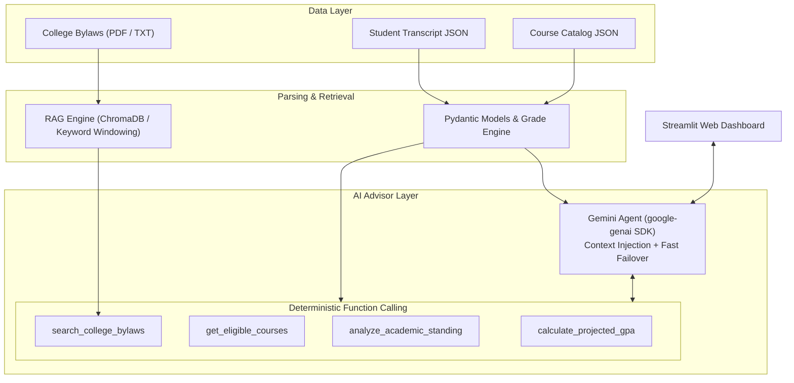

# 🎓 Smart Academic Advisor

[](https://www.python.org/)
[](https://ai.google.dev/)
[](https://streamlit.io/)
[](https://docs.pydantic.dev/)

An AI-powered **Smart Academic Advisor** built with **Python**, the **`google-genai` SDK**, and **Streamlit**.  
It combines **Retrieval-Augmented Generation (RAG)** over official university credit-hour bylaws with **deterministic Function Calling tools** so that every GPA calculation, prerequisite check, and course recommendation is mathematically exact and grounded in academic regulations.

---

## ✨ Key Features

- **📜 Bylaws RAG Engine (`core/rag_engine.py`)**: Parses university credit-hour regulation PDFs and retrieves relevant articles (probation rules, credit limits, repetition policies, graduation & honors criteria) on demand.
- **🧮 Deterministic Function Calling Tools (`core/tools.py`)**:
  - `calculate_projected_gpa`: Computes exact semester and cumulative GPA projections for new courses and repeated/retaken courses without LLM guesswork.
  - `get_eligible_courses`: Validates the prerequisite graph in Python, filters out completed and currently registered courses, and flags active failed courses as priority retakes.
  - `analyze_academic_standing`: Determines academic standing, permitted credit-hour load, graduation progress (140 credit hours), and honors degree eligibility.
  - `search_college_bylaws`: Queries indexed faculty bylaws articles directly from the agent loop.
- **⚡ Low-Latency Gemini Agent (`core/advisor_agent.py`)**: Uses direct student-context injection and automatic zero-delay model failover (`gemini-3.5-flash-lite` → `gemini-3.5-flash` → `gemini-3.8-flash`) to handle API demand spikes seamlessly.
- **📊 Automated Grading Scale Engine (`config.py`, `utils/transcript_parser.py`)**: Automatically computes course quality points, pass/fail status, course-repetition replacement rules, and cumulative GPA strictly according to the official 4.0 grading scale.
- **💻 Interactive 4-Tab Streamlit Dashboard (`app.py`)**:
  1. **AI Advisor Chat**: Conversational advisor with quick-prompt shortcuts and tool-backed answers.
  2. **Editable Transcript (`st.data_editor`)**: Inline editing of course grades, credit hours, and semesters with automatic GPA recalculation.
  3. **What-If GPA Simulator**: Pre-populated with currently registered semester courses and active failed courses for instant scenario modeling.
  4. **Course Catalog & Prerequisites**: Searchable curriculum explorer with prerequisite chains.

---

## 🏗️ System Architecture



---

## 📁 Project Structure

```text
smart-academic-advisor/
├── ADVISOR_PLAN.md                   # Architectural design & implementation roadmap
├── README.md                         # Project overview & setup guide
├── requirements.txt                  # Python dependencies
├── .env.example                      # Environment variable template
├── .gitignore                        # Excludes secrets (.env) & personal student records
├── config.py                         # Grading scale, bylaw rules, paths, and model config
├── test_core.py                      # Core logic & GPA calculation verification suite
├── app.py                            # Interactive Streamlit application
├── core/
│   ├── __init__.py
│   ├── advisor_agent.py              # Gemini client wrapper with tools & fast failover
│   ├── rag_engine.py                 # Bylaws document indexing & retrieval engine
│   └── tools.py                      # Deterministic Function Calling tools
├── data/
│   ├── college_bylaws.txt            # Extracted credit-hour academic regulations
│   ├── course_catalog.json           # Full curriculum catalog & prerequisite tree
│   ├── courses.json                  # Structured course definitions
│   └── student_record.example.json   # Sample anonymized student transcript (safe for demo)
└── utils/
    ├── __init__.py
    ├── pdf_loader.py                 # PDF text extraction & chunking utilities
    └── transcript_parser.py          # Pydantic schemas & automated GPA calculations
```

---

## 📈 Official Grading Scale (4.0 System)

Course quality points are calculated automatically as `Grade Points × Credit Hours`:

| Letter Grade | Points / Credit | Percentage Range | 3-Credit Course | 2-Credit Course |
| :---: | :---: | :--- | :---: | :---: |
| **A** | 4.000 | 90% and above | 12.000 | 8.000 |
| **A-** | 3.666 | 85% to < 90% | 10.998 | 7.332 |
| **B+** | 3.333 | 80% to < 85% | 9.999 | 6.666 |
| **B** | 3.000 | 75% to < 80% | 9.000 | 6.000 |
| **B-** | 2.666 | 70% to < 75% | 7.998 | 5.332 |
| **C+** | 2.333 | 65% to < 70% | 6.999 | 4.666 |
| **C** | 2.000 | 60% to < 65% | 6.000 | 4.000 |
| **C-** | 1.666 | 56% to < 60% | 4.998 | 3.332 |
| **D+** | 1.333 | 53% to < 56% | 3.999 | 2.666 |
| **D** | 1.000 | 50% to < 53% | 3.000 | 2.000 |
| **F / (F) / Abs** | 0.000 | Below 50% / Absent | 0.000 | 0.000 |

---

## 🚀 Quick Start

### 1. Clone the Repository
```bash
git clone https://github.com/eltayeb22/smart-academic-advisor.git
cd smart-academic-advisor
```

### 2. Create a Virtual Environment & Install Dependencies
```bash
python -m venv .venv
# Windows:
.venv\Scripts\activate
# macOS / Linux:
source .venv/bin/activate

pip install -r requirements.txt
```

### 3. Configure Environment Variables
Copy `.env.example` to `.env` and add your Google Gemini API key (free keys are available via [Google AI Studio](https://aistudio.google.com/)):
```bash
cp .env.example .env
```
*(You can also enter your API key directly from the Streamlit sidebar at runtime.)*

### 4. (Optional) Use Your Own Academic Transcript
By default, the app loads the anonymized sample file `data/student_record.example.json`.  
To use your own transcript privately (kept out of Git via `.gitignore`):
```bash
cp data/student_record.example.json data/student_record.json
```
Then edit your details directly in the JSON file or interactively inside the Streamlit dashboard.

### 5. Run the Application
```bash
streamlit run app.py
```

### 6. Run the Automated Core Tests
```bash
python test_core.py
```

---

## 🔒 Privacy & Security

- **API Secrets**: `.env` is excluded via `.gitignore` and never committed.
- **Personal Academic Records**: `data/student_record.json` is excluded via `.gitignore`. Only the fictional demo file (`data/student_record.example.json`) is tracked in this public repository.
